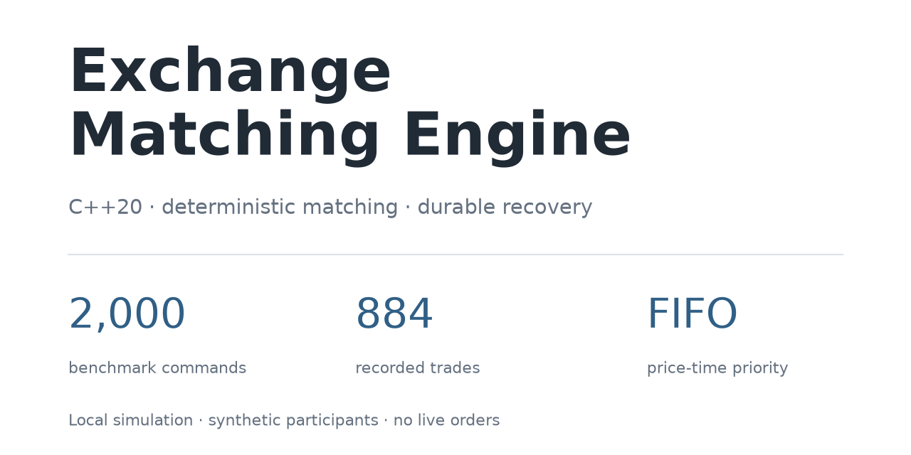
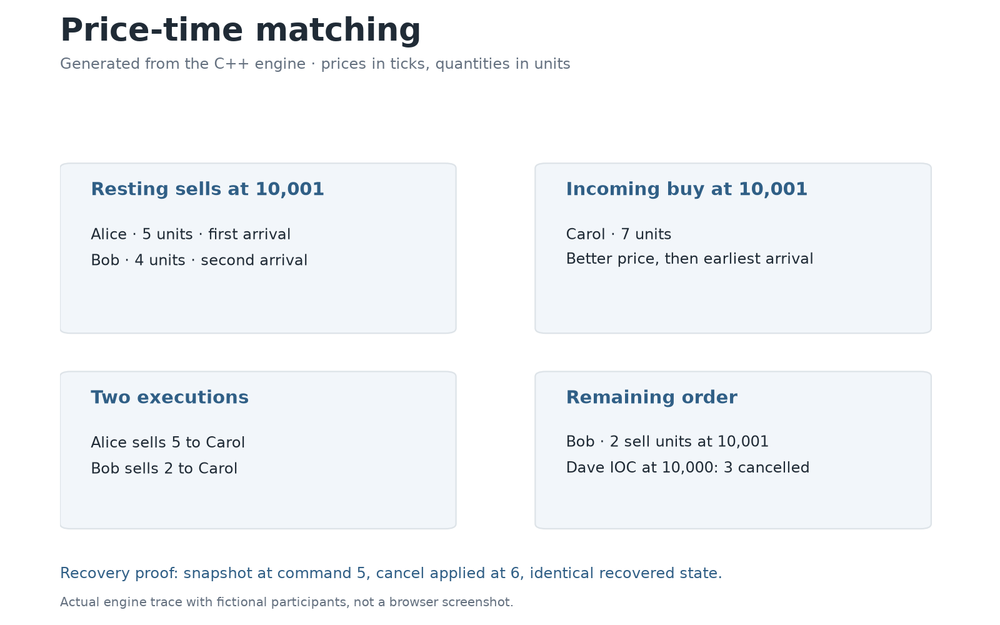
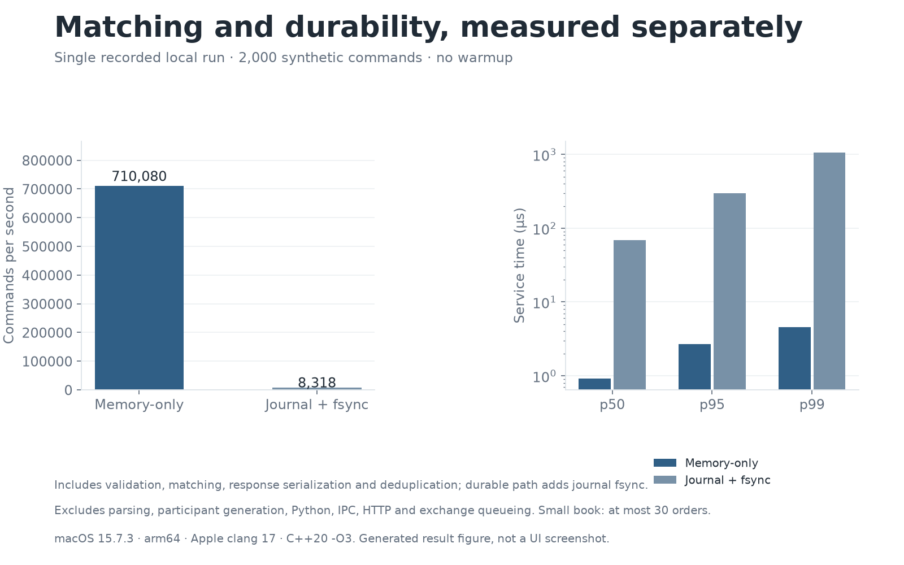

# Exchange Matching Engine

<!-- project-navigation:start -->
[Architecture](docs/ARCHITECTURE.md) · [Design choices](docs/DECISIONS.md) · [Portfolio](docs/PORTFOLIO.md) · [Demo and deployment](docs/DEPLOYMENT.md) · [Recorded demo](https://exchange-matching-engine.pages.dev)
<!-- project-navigation:end -->

A C++20 exchange simulator with price-time priority, durable command handling, materialized snapshots and deterministic replay.

[Portfolio case study](docs/PORTFOLIO.md) · [Architecture and protocol](docs/ARCHITECTURE.md) · [Benchmark evidence](docs/benchmark.json) · [Checks](https://github.com/victorhuii/exchange-matching-engine/actions)



## What it demonstrates

- **Matching:** integer ticks and quantities, limit and IOC orders, partial fills, cancellations and resting-price execution.
- **Priority:** ordered price levels, FIFO queues and an order index for cancellation.
- **Durability:** checksummed journal records, fsync before acknowledgment, atomic materialized snapshots and one-writer locking.
- **Retries:** deduplication survives recovery; conflicting request reuse is rejected.
- **Evidence:** an independent Python reference, conservation checks, deliberate crash points and corruption handling.
- **Workbench:** order entry, depth, executions, balances, isolated replay, recovery comparison and session export.

All participants and orders are simulated. No live trading or brokerage integration. Prices are abstract ticks; cash is ticks × quantity units, not dollars.

## Quick start

Requires a C++20 compiler and Python 3.11+ on macOS/Linux. Verified with Apple clang 17 and Python 3.14.2. Node 24 is only needed for frontend checks. There are **no application package or frontend build dependencies**.

```sh
git clone https://github.com/victorhuii/exchange-matching-engine.git
cd exchange-matching-engine
python3 -m exchange.server
```

The first run compiles the core. Open **http://127.0.0.1:8766**. Stop with Ctrl+C. Use `--port 8767 --data runtime/another-session` for another port or fresh session.

Install Xcode Command Line Tools on macOS if a compiler is missing; use a C++20-capable GCC or Clang on Linux. Set `CXX` to an alternate compiler executable if needed. Compilation downloads no packages.

## Demo



*Generated from engine output, not a UI screenshot. Alice's earlier five-unit ask fills before Bob's, which partially fills and retains two units.*

1. Submit a buy from Alice, then a sell at the same price from Bob.
2. Inspect executions, remaining quantity and conserved balances.
3. Run 100 synthetic commands; each response is checked against the independent reference.
4. Save a snapshot, then recover and compare full state.
5. Open Replay to inspect 60 isolated seeded commands without changing the durable session.
6. Export the session or inspect recorded benchmarks.

State persists in `runtime/exchange/`. One C++ process owns each data directory. A second writer is rejected.

## Measured performance

| Processing path | Commands / second | p50 service time | p95 | p99 |
| --- | ---: | ---: | ---: | ---: |
| Memory-only C++ | 710,080 | 0.917 µs | 2.708 µs | 4.541 µs |
| Journal + per-command fsync | 8,318 | 68.291 µs | 298.375 µs | 1,058.250 µs |

One recorded run on macOS 15.7.3 / arm64 / Apple clang 17, built with C++20 and `-O3 -DNDEBUG`. The 2,000-command workload produced 884 trades, included 292 cancellations and 567 IOC orders, and reached 30 resting orders. No warmup.

Timers include validation, matching, JSON response serialization and request caching. The durable path adds checksum and journal write/fsync. Generation, parsing, Python, IPC, HTTP and exchange queueing are excluded. Scheduling, storage and filesystem behavior affect results; small-book measurements do not establish production exchange capacity.



See [benchmark.json](docs/benchmark.json) for full metadata. The UI reports bridge round-trip time separately; it is not C++ matching latency.

## Verify and reproduce

```sh
python3 scripts/build.py
python3 -m unittest discover -s tests -v
node --check web/app.js
node --test tests/frontend.test.cjs
python3 -m scripts.benchmark
python3 -m scripts.demo
```

**Local evidence:** 17 Python tests and 3 frontend checks passed. A 2,000-command run also completed with address and undefined-behavior sanitizers. CI runs checks on Linux; its current remote status is on the Actions page.

The reference comparison checks 1,200 generated commands. Recovery checks cover crashes before persistence, persisted-but-unacknowledged commands, interrupted snapshots, torn journal tails, checksum corruption and restored responses/used IDs. Invariants cover cash/quantity conservation, positive remainders and an uncrossed resting book.

## Durability contract

A command is validated, appended to the checksummed journal and fsynced before matching and acknowledgment. Recovery may include a command whose acknowledgment never arrived. Retry its original request ID and canonical command to receive the cached response without matching twice.

Materialized snapshots preserve orders, balances, trades, used IDs and cached responses. Creation uses a temp file, fsync, atomic rename and directory fsync. Recovery verifies the snapshot and entire retained journal, then applies records after the snapshot. Incomplete final lines are truncated; complete corrupt records and sequence gaps fail closed.

These guarantees assume OS/filesystem behavior. POSIX fsync does not cover every hardware power-loss scenario; macOS F_FULLFSYNC and controller cache policies are outside the implementation. Checksums detect accidental corruption, not malicious modification.

## Boundaries

One instrument, matching thread and writer. No market orders, auctions, hidden liquidity, replace orders, funding checks or self-trade prevention. Participant names are simulator identities, not authenticated accounts.

The workbench caps at 5,000 accepted commands; the core caps at 100,000. Journal, responses and trades are retained in full. No compaction or distributed failover. The HTTP server is loopback-only and not designed for internet exposure.

Browser capture was unavailable, so actual UI screenshots and visual layout QA remain incomplete. The figures use engine/benchmark output; frontend checks use a minimal DOM harness.

## Portfolio materials

- [Complete portfolio Markdown](docs/PORTFOLIO.md): project card, case study, tradeoffs, measurements, resume bullets, captions and alt text.
- [PNG and editable SVG visuals](docs/assets/): cover, matching trace, order-book state and benchmarks.
- [Recorded engine demo](docs/demo/session.json) and [isolated replay](docs/demo/replay.json).
- [GitHub description, topics and social-preview notes](.github/ABOUT.md).
- [Project scope](PROJECT_SCOPE.md) and [continuation context](docs/STATUS.md).

Optional image regeneration:

```sh
python3 -m pip install -r requirements-assets.txt
MPLCONFIGDIR=/tmp/exchange-matplotlib python3 scripts/portfolio_assets.py
```

This is a separate systems implementation from [MarketLab](https://github.com/victorhuii/market-research-lab), which focuses on market-making research and assumed historical fills.

## Deeper workload evidence

[Repeated stress benchmarks](docs/STRESS_BENCHMARKS.md) cover growing 10,000-level books, cancellation bursts, and multi-maker sweeps in memory and fsync-backed modes. All 24 raw samples are retained with source/workload/state identities; timing excludes transport and does not establish production exchange latency.

## Recovery campaign

A repeatable mixed-session campaign now checks snapshot/journal recovery and original-ID retries across process exits and kills. The recorded run covers 900 commands, 90 restarts and 945 full-state comparisons against the independent reference. [Counts, reproduction and limits](docs/RECOVERY_CAMPAIGN.md).
