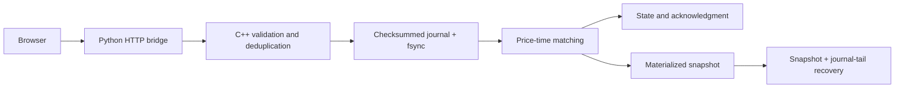

# Architecture and protocol

## Components

| Component | Responsibility |
| --- | --- |
| `src/engine.cpp` | Matching, validation, deduplication, balances, journal, snapshots, recovery and benchmarking |
| `exchange/bridge.py` | Typed command encoding and synchronized IPC with a persistent C++ process |
| `exchange/reference.py` | Independent list-based Python oracle and synthetic flow |
| `exchange/server.py` | Loopback HTTP workbench, demo, isolated replay and export |
| `web/` | Plain HTML/CSS/JavaScript and SVG depth visualization |
| `scripts/` | Build, benchmark, recorded demo and optional portfolio figures |

The Python server does not implement live matching. Its reference checks synthetic demo responses; live state comes from C++. An application lock serializes HTTP mutations, a bridge lock serializes IPC, and the C++ child runs a deterministic matching loop. A POSIX file lock rejects a second writer.



## Book structures and rules

Buy price levels use a descending `std::map`; sell levels use an ascending map. Each level holds a FIFO `std::list<Order>`. An `unordered_map` maps order IDs to side, price and list iterator.

Matching consumes the best opposite level's earliest order and executes at its price. Partial fills reduce remaining quantity. Filled orders and empty levels are removed. GTC remainders join their level's tail; IOC remainders are cancelled.

Price-level lookup/creation costs O(log P). Order-index lookup is expected O(1), and list erasure is O(1), but cancellation also looks up the level. Matching cost depends on fills and removed levels. Hash lookup is not a worst-case constant-time guarantee.

Inputs: prices 1–100,000,000 ticks; quantities 1–100,000 units; IDs 1–100 ASCII letters/digits or `_.:-`. Sides are buy/sell; TIF is GTC/IOC. IDs remain used after fill/cancel. Only the original participant can cancel a resting order. Serialized command order determines cancellation/fill races.

Participant names are not authentication. Self-trades are allowed and net balances. No funding constraints apply. Cash is a decimal string in JSON to preserve precision in JavaScript. The price, quantity and command caps bound integer arithmetic.

## C++ line protocol

One tab-separated command per stdin line and one JSON response per stdout line:

```text
O<TAB>request_id<TAB>order_id<TAB>participant<TAB>B|S<TAB>price<TAB>quantity<TAB>GTC|IOC
C<TAB>request_id<TAB>order_id<TAB>participant
STATE
SNAPSHOT
RECOVER
```

The CLI defaults to memory-only. Pass `--data DIRECTORY` for durability. The server always supplies a durable directory.

Responses contain `ok` plus `result` or `state`. Order/cancel results contain `sequence`, `order_id`, `filled`, `resting`, `cancelled` and `trades`. Errors contain `ok: false`, `error` and `kind` (input/storage). Duplicate comparisons use canonical typed commands, not JSON field order. Unknown JSON fields are not passed to C++.

## Persistence

`commands.log` stores sequence, canonical command and a 64-bit FNV-1a checksum. Validation precedes writes. Appends are fsynced before matching and acknowledgment. Creating the journal also syncs its directory.

Storage or post-persistence application exceptions poison the instance and block submissions until successful recovery/reopen. A command may persist without an acknowledgment; callers must retain request IDs across ambiguous failures. The UI retains a pending order in page memory only; reload loses that retry context.

`snapshot.dat` contains schema version, sequence, queues, balances, trades, used IDs and original request responses, with a checksum over its payload. The temporary file is fsynced, renamed and followed by directory fsync. The journal is retained.

Recovery verifies the snapshot, checks all journal sequences/checksums, and applies only records after the snapshot. Torn final lines are truncated. Complete invalid records, sequence gaps, duplicate requests and an ahead-of-journal snapshot fail closed. Leftover temporary snapshots are ignored.

Snapshots reduce reconstruction work but retain full-journal verification cost. There is no compaction. Checksums detect accidental corruption, not malicious modification. Guarantees depend on OS/filesystem fsync/rename behavior; macOS F_FULLFSYNC is not issued.

## Crash injection

| CLI flag | Boundary | Expected recovery |
| --- | --- | --- |
| `--failpoint before_journal` | Before append | Command absent |
| `--failpoint after_journal` | After fsync, before apply/ack | Command recovered; same-ID retry deduplicated |
| `--failpoint snapshot_before_rename` | After temp snapshot persistence | Journal and prior snapshot remain authoritative |

Failpoints are not exposed over HTTP. Tests also verify torn tails, corrupted checksums, restored responses/used IDs, one-writer locking and blocked submissions after failed recovery.

## HTTP routes

| Method | Route | Result |
| --- | --- | --- |
| GET | `/api/state` | Live state |
| POST | `/api/command` | Order/cancel |
| POST | `/api/demo` | 100 synthetic commands checked against reference |
| POST | `/api/snapshot` | Save materialized snapshot |
| POST | `/api/recover` | Reload and compare state |
| GET | `/api/replay` | 60 isolated C++ replay events |
| GET | `/api/benchmark` | Recorded benchmark or null |
| GET | `/api/export` | State, canonical commands and benchmark download |

Order body:

```json
{"type":"order","request_id":"r1","order_id":"o1","participant":"alice","side":"buy","price":10000,"quantity":5,"tif":"GTC"}
```

Cancel body:

```json
{"type":"cancel","request_id":"r2","order_id":"o1","participant":"alice"}
```

Only loopback hosts are accepted. JSON writes reject cross-origin browser requests. Body cap: 1 MB. Workbench cap: 5,000 accepted commands, with duplicate retries still permitted. Synthetic batches are individual durable commands, not an atomic transaction.

## Benchmark interpretation

The C++ benchmark pre-generates seed-42 flow, then times submissions on one thread. Memory timings include validation, matching, response serialization and request caching. Durable timings add checksum, open/append, fsync and close. Generation, parsing, Python, IPC and HTTP are excluded. Throughput includes timing/loop overhead. Percentiles describe service time, not queueing delay.

C++ and Python generators use different random implementations; each is deterministic but they do not emit the same stream. The committed run is a small-book measurement with no warmup or repeated-run confidence interval. Core service time, bridge round trip and end-to-end latency are separate quantities.
