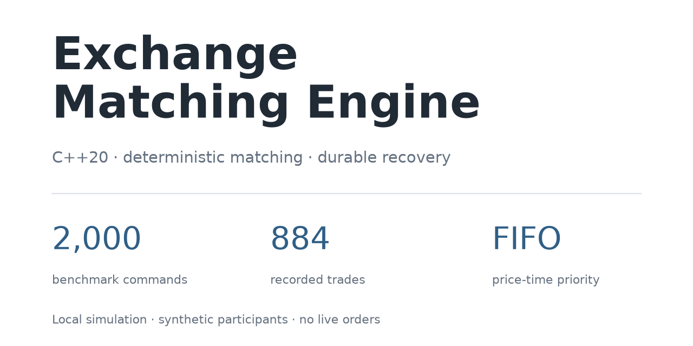
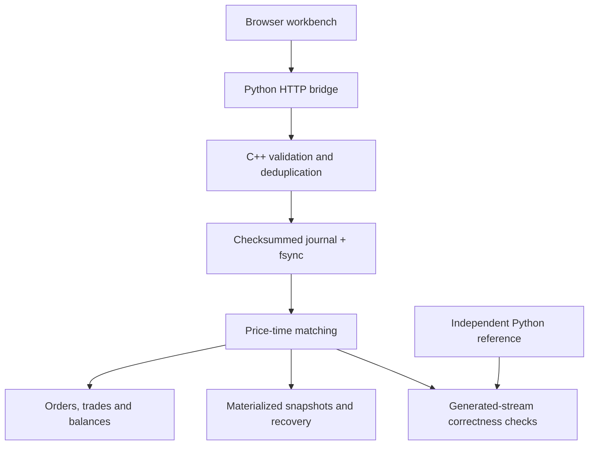
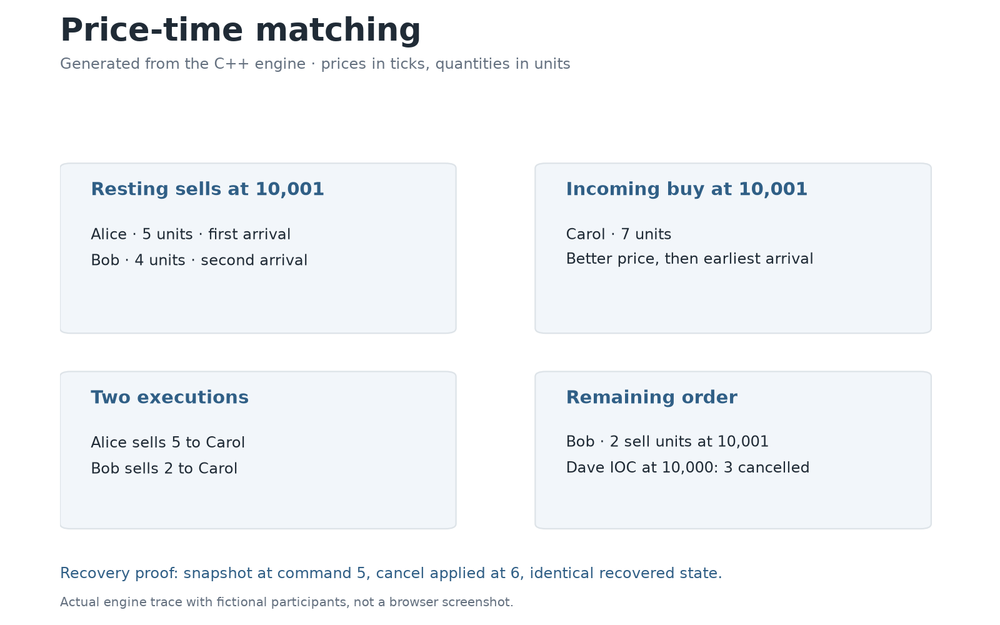
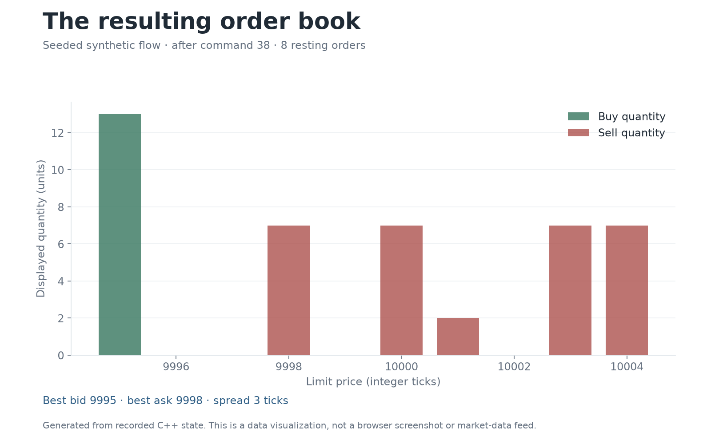
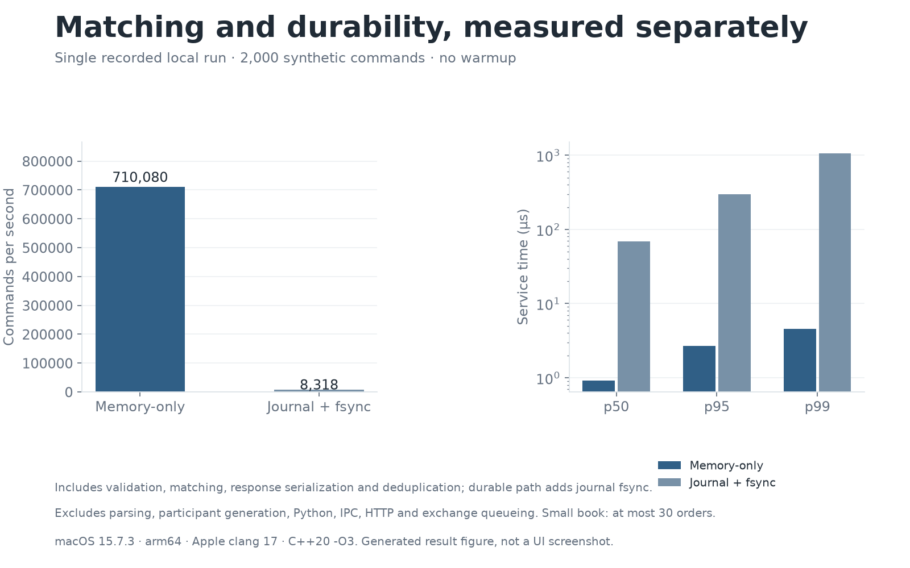

# Exchange Matching Engine



## Project card

**Title:** Exchange Matching Engine

**Subtitle:** Deterministic matching, durable commands, verifiable recovery.

**Short description:** A C++20 exchange simulator that matches limit and IOC orders using price-time priority, persists accepted commands, and recovers identical orders, trades and balances after restart.

**Tags:** C++, systems engineering, market microstructure, data structures, reliability.

**Source:** [GitHub](https://github.com/victorhuii/exchange-matching-engine).

**Demo:** Local application; no hosted service currently published.

**Ownership:** Personal project, implemented with Codex assistance.

## Case study

### Why I built it

I wanted a systems project with behavior I could specify precisely and test against an independent implementation. An exchange makes those questions concrete: which order trades first, what cancellation means after a fill, and what happens when the process dies before the client receives acknowledgment.

### What I built

The C++ core maintains ordered buy/sell price levels, FIFO queues and an order index. It supports limit and IOC orders, partial fills, resting-price execution and participant balances. Accepted commands receive ordered sequences. Duplicate requests return their original response after recovery; conflicting reuse is rejected.

The durable path validates a command, appends a checksummed journal record and fsyncs it before matching and acknowledging. Materialized snapshots preserve orders, balances, trades, used IDs and cached responses. Recovery verifies persisted records and applies the journal tail.

A Python standard-library server connects the core to a plain browser workbench. I can submit orders, inspect depth and executions, run synthetic participants, save snapshots, compare recovered state and export a session. An isolated replay steps through 60 seeded commands without changing the durable exchange.

### Architecture



### Decisions and tradeoffs

| Decision | Reason | Cost |
| --- | --- | --- |
| C++20 core | Direct control of book structures; distinct systems implementation | Ownership/iterator correctness needs testing |
| Integer arithmetic | Exact matching and conservation | External quantities need explicit unit conversion |
| Ordered levels + FIFO lists | Clear price-time priority and indexed cancellation | Tree operations/allocations remain in hot path |
| Fsync before acknowledgment | Precise, testable recovery contract | Storage materially reduces throughput |
| Materialized snapshots | Complete state and response restoration | Full retained journal is still verified |
| Independent reference | Generated behavior checked outside the C++ implementation | Correctness evidence, not a speed comparison |
| Plain local UI | No accounts, credentials or runtime package dependencies | No hosted/shared exchange |

### Correctness and recovery evidence

**17 Python tests and 3 Node frontend checks pass locally.** A 1,200-command stream is compared response-by-response with an independent list-based Python reference. Checks cover priority, partial fills, cancellations, integer validation, retries and cash/quantity conservation.

Failure tests cover pre-append crashes, persisted-but-unacknowledged commands, interrupted snapshots, torn tails, checksum corruption, one-writer locking, restored filled-order IDs/original responses, and blocked submissions after failed recovery.

The committed walkthrough saves a snapshot at command 5, applies a cancellation at command 6, closes the process and opens a new one. Recovered state is identical. See [session.json](demo/session.json).

A 2,000-command run also completes under address and undefined-behavior sanitizers. Linux CI is configured; its current remote result is on the repository Actions page.

### Recorded performance

| Path | Commands / second | p50 | p95 | p99 |
| --- | ---: | ---: | ---: | ---: |
| Memory-only C++ | 710,080 | 0.917 µs | 2.708 µs | 4.541 µs |
| Journal + fsync | 8,318 | 68.291 µs | 298.375 µs | 1,058.250 µs |

One run, no warmup: macOS 15.7.3 / arm64 / Apple clang 17, C++20 `-O3 -DNDEBUG`. The 2,000-command workload produces 884 trades, includes 292 cancellations and 567 IOC orders, and reaches 30 resting orders.

Timings include validation, matching, response serialization and request caching. Durable processing adds journal checksum/write/fsync. Generation, parsing, Python, IPC, HTTP and exchange queueing are excluded. Scheduling and storage affect results; this does not establish production exchange capacity.

### What I learned

Matching and durability have different costs and failure modes. A fast in-memory result does not describe a durable request path. Missing acknowledgment does not prove a command was lost. Request identity and recovery belong in the same design, and snapshots must preserve original responses as well as visible orders.

### Boundaries and next steps

One instrument, matching thread and writer. No live trading, market orders, auctions, hidden liquidity, replace orders, funding checks or self-trade prevention. Participants are simulator identities. Prices/cash are abstract ticks, not USD.

The workbench caps at 5,000 commands and the CLI at 100,000. Journal, trades and responses are retained in full. Next steps: deeper-book/repeated benchmarks, memory profiling, journal compaction with recovery tests, and actual browser layout QA.

Durability assumes OS/filesystem fsync and rename behavior. Checksums detect accidental corruption, not malicious modification; macOS F_FULLFSYNC is not used. Browser capture was unavailable, so the figures below are not UI screenshots and layout is not visually verified.

## Demo images

Figures use committed measurements or actual C++ output. Orders and participants are synthetic. Each PNG has an editable SVG counterpart.

### Matching trace



**Caption:** FIFO priority, partial fills and IOC cancellation, with a recorded snapshot-and-tail recovery proof.

**Alt text:** Carol buys seven units at 10001 ticks, filling Alice's earlier five-unit ask and two of Bob's four. Bob retains two units. Dave's buy at 10000 does not cross and is cancelled.

**Size:** 1600 × 1000.

### Order-book state



**Caption:** Recorded C++ state aggregated into price levels. This is synthetic order flow, not a historical market feed.

**Alt text:** Buy/sell quantity bars at integer limit prices, with best bid, best ask and spread from the selected replay event.

**Size:** 1600 × 1000.

### Benchmark comparison



**Caption:** Memory-only and durable processing measured separately. The latency panel uses a logarithmic scale.

**Alt text:** Throughput and p50/p95/p99 service times for memory-only and fsync-backed processing, with timing exclusions below.

**Size:** 1600 × 1000.

### Cover / social preview

**File:** `assets/portfolio-cover.png`, 1280 × 640.

**Alt text:** Exchange Matching Engine cover showing C++20, deterministic matching, durable recovery, 2000 benchmark commands and 884 trades.

**Use:** Portfolio card or GitHub social preview. The image is prepared; committing it does not set the social-preview field.

## Website reuse

Copy this Markdown file and `assets/` together, or place the images in your site's public directory and update paths. Frontmatter is starter metadata; adapt keys to your site's content schema.

| Asset | External PNG URL |
| --- | --- |
| Cover | https://raw.githubusercontent.com/victorhuii/exchange-matching-engine/main/docs/assets/portfolio-cover.png |
| Matching | https://raw.githubusercontent.com/victorhuii/exchange-matching-engine/main/docs/assets/matching-demo.png |
| Order book | https://raw.githubusercontent.com/victorhuii/exchange-matching-engine/main/docs/assets/order-book-demo.png |
| Benchmark | https://raw.githubusercontent.com/victorhuii/exchange-matching-engine/main/docs/assets/benchmark-demo.png |

SVGs use the same names with `.svg`. Locally copied files make your portfolio self-contained. These `main` URLs follow updates; use commit-pinned URLs for immutable evidence.

## Resume-ready bullets

- Built a C++20 price-time matching engine with FIFO queues, indexed cancellations, limit/IOC orders, partial fills and integer participant balances.
- Implemented checksummed journaling, fsync-backed acknowledgments, materialized snapshots and request deduplication; verified recovery across injected crashes, torn writes and corrupted records.
- Validated 1,200 generated commands against an independent Python reference and measured memory-only/durable service times on a documented 2,000-command local workload.

**Optional benchmark bullet:** Measured 710k commands/s memory-only and 8.3k commands/s with per-command journal fsync on a 2,000-command local single-threaded workload with at most 30 resting orders; excluded networking and IPC.

Keep those qualifications attached. Do not call the 710k figure durable or networked throughput.

## Two-minute demo

1. Submit two same-price sells from different participants.
2. Submit a buy that fills the earlier order and partially fills the next.
3. Submit a non-crossing IOC and inspect cancellation.
4. Run synthetic participants and inspect depth, trades and balances.
5. Save a snapshot, submit another command, then recover and compare.
6. Step through isolated replay, show both benchmark paths, and export the session.

## Run and reproduce

```sh
git clone https://github.com/victorhuii/exchange-matching-engine.git
cd exchange-matching-engine
python3 -m exchange.server
```

Open `http://127.0.0.1:8766`. C++20 compiler and Python required; macOS/Linux supported. Compilation is automatic; no API keys or paid services.

```sh
python3 -m unittest discover -s tests -v
node --test tests/frontend.test.cjs
python3 -m scripts.benchmark
python3 -m scripts.demo
```

## Evidence

- [Source repository](https://github.com/victorhuii/exchange-matching-engine)
- [C++ implementation](../src/engine.cpp)
- [Independent reference](../exchange/reference.py)
- [Architecture and protocol](ARCHITECTURE.md)
- [Recorded benchmark](benchmark.json)
- [Recovery demo](demo/session.json)
- [Sixty-command replay](demo/replay.json)
- [Release scope](../PROJECT_SCOPE.md)
- [README](../README.md)

## Follow-up: stress coverage

Added independently checked deep-book, reverse-cancellation, and multi-maker sweep workloads. Repeated measurements cover 10,000 commands per run across four profiles and two storage modes; 24 raw samples retain source, workload, and final-state identities. The deepest case reaches 10,000 resting orders at distinct prices. [Evidence and timing limits](STRESS_BENCHMARKS.md). These are service-time measurements, not network or production latency.

## Recovery campaign extension

A five-seed mixed-session campaign checked 900 commands through 40 journal-boundary exits, 45 forced post-acknowledgment kills, 40 snapshots and 90 restarts, with 945 full-state comparisons against the independent reference. All 61 prefixes of a final candidate journal record were also tested. These are bounded process/file fixtures, not machine-power-loss or arbitrary-storage-failure guarantees. [Measured evidence](RECOVERY_CAMPAIGN.md).
